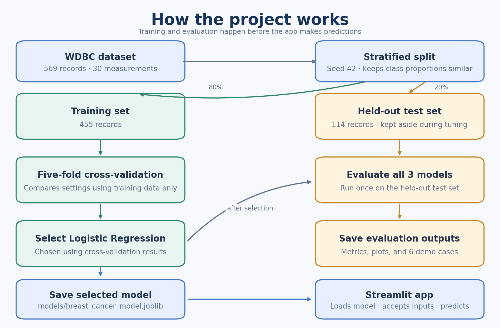

# Breast Cancer Prediction Prototype

This is a learning project built with Python, Streamlit, FastAPI, and SQLite. It uses 30 cell nucleus measurements from the Wisconsin Diagnostic Breast Cancer (WDBC) dataset to predict whether a record is labeled **benign** or **malignant**.

> **Important:** This is a classroom demonstration, not a diagnostic tool. Its predictions are not medical advice or calibrated estimates of a person's cancer risk.

## Run the app

If you have not downloaded the project yet, clone the repository and enter its folder:

```bash
git clone https://github.com/OtieteAyebanua/brestCancerdetection.git
cd brestCancerdetection
```

The project was run with Python 3.9.6. Install that version, then from the project folder create an environment and install the required packages.

macOS/Linux:

```bash
python3.9 -m venv .venv
source .venv/bin/activate
python -m pip install --upgrade pip
python -m pip install -r requirements.txt
uvicorn server:app --port 8000 &
streamlit run app.py --server.port 3001
```

Windows PowerShell (run the server and the app in two separate terminals, both with the environment activated):

```powershell
py -3.9 -m venv .venv
.venv\Scripts\Activate.ps1
python -m pip install --upgrade pip
python -m pip install -r requirements.txt
uvicorn server:app --port 8000
# In a second terminal:
streamlit run app.py --server.port 3001
```

The app needs the prediction server running. On its first start, the server creates the SQLite database at `data/breast_cancer.db` and loads the WDBC records into it.

Open <http://localhost:3001> for the app. While the server is running, <http://localhost:8000/docs> shows its interactive API page. Stop each one with **Ctrl+C**.

Once the environment is set up, you can start both the server and the app from the project folder with `./run` on macOS/Linux. Stopping the app with **Ctrl+C** also stops the server. Always start the server from the project folder, because it reads and writes files there.

## Using the app

The app collects 30 measurements in three sections: **Mean**, **Standard error**, and **Worst**. Each section has 10 measurements. Enter all 30 values and choose **Get prediction**. The app displays its predicted class and the **probability of malignancy** estimated by the model. The probability is not calibrated as an individual risk estimate.

Choose **Load held-out demo case** to fill the form with one of six saved test examples. The app cycles through the examples. After you request a prediction, it displays the example's actual label beside the model's prediction. These examples are for demonstrating the app; they are not new clinical cases.

If a value is outside the range seen during training, the app warns that the prediction may be unreliable and still shows the model output. Use **Clear inputs** to reset the form.

### Doctor review and retraining

Every prediction is saved to the database. Under each result, a **Doctor review** section asks whether the model classification is correct. Turn on **The AI prediction is correct** if the doctor agrees, or leave it off if the diagnosis is the other class; the app shows which diagnosis will be recorded. Choose **Submit review** to save it. Each prediction can be reviewed once.

A reviewed case is added to the training data with the doctor's confirmed diagnosis. If the toggle is on, that is the model's answer; if it is off, it is the other class. The server then retrains the model in the background, so the doctor does not have to wait. The new model version is used from the next prediction, and the page header shows the new version number and how many training records came from reviews.

Each retrain starts from scratch. It loads every training record from the database (the 455 WDBC records plus all reviewed cases so far), tunes `C` again with cross-validation, and fits a new model. It does not adjust the previous model. With this amount of data, a retrain takes a few seconds. Reviews submitted during a retrain are included in the next one.

Two kinds of review are saved but not used for training, and do not trigger a retrain:

- **Held-out test records,** such as the demo cases. Training on them would make the test scores meaningless, because the model would be tested on data it had learned from.
- **Records already in the training data,** which already have a confirmed label.

The test set never changes, so every model version is scored on the same 114 records and the versions can be compared fairly. To see how each version scored:

```bash
sqlite3 data/breast_cancer.db "SELECT id, trained_at, training_records, review_records, test_recall, test_roc_auc FROM model_versions;"
```

## How the project works

1. `database.py` creates the SQLite database and loads the 569 WDBC records into it, split into training and test sets.
2. `train_model.py` reads the training records from the database: the original WDBC training set plus any doctor-reviewed cases.
3. It tunes a Logistic Regression classifier using cross-validation on the training set.
4. It evaluates the tuned model once on the held-out test set.
5. It saves the model, records the new model version and its scores in the database, and writes the supporting reports.
6. `server.py` loads the saved model, makes predictions, stores them and their reviews, and runs `train_model.py`'s training again after each review.
7. `app.py` is the web page. It sends measurements and reviews to the server and displays the results.

### The database

The database file is `data/breast_cancer.db`. It has four tables:

| Table | What it holds |
| --- | --- |
| `records` | The training and test records: the 569 WDBC records and any doctor-reviewed cases, each with its 30 measurements, label, split, and source (`wdbc` or `review`). |
| `predictions` | Every prediction the app makes: the measurements, predicted class, probability of malignancy, and model version. |
| `reviews` | Each doctor review: whether the prediction was correct, the confirmed diagnosis, and either the training record it created or why it was not used for training. |
| `model_versions` | One row per training run: how many records it used, how many came from reviews, and its test scores. |

The tables are linked: each prediction points to the model version that made it, each review points to its prediction, and a review that was used for training points to the record it created. The schema is the `SCHEMA` text in [`database.py`](database.py). To print it with all 30 measurement columns filled in, run `sqlite3 data/breast_cancer.db ".schema"`.

You can open the file with any SQLite tool, for example `sqlite3 data/breast_cancer.db "SELECT * FROM reviews;"`. The database is not committed to git because it holds the app's saved predictions.

### The server

`server.py` is a FastAPI server on port 8000. The app talks to it over these endpoints:

| Endpoint | What it does |
| --- | --- |
| `GET /health` | Confirms the server is running. `./run` uses it to know when to start the app. |
| `GET /model` | Describes the loaded model: version, number of training records, test scores, and whether it is retraining. |
| `POST /predictions` | Takes the 30 measurements, returns the predicted class, probability of malignancy, and any out-of-range warnings, and saves the prediction. |
| `POST /predictions/{id}/review` | Saves the doctor's verdict on a prediction, adds the case to training if it is new, and starts a retrain. |

The server rejects requests with missing, extra, negative, or non-numeric measurements (error 422), reviews of unknown predictions (404), and second reviews of the same prediction (409). When it starts, it creates and seeds the database if needed, and trains a model if the saved model file does not match the latest version in the database.



*Figure 1. Project workflow. The held-out test set is used for evaluation after cross-validation tuning is complete.*

The split is stratified, meaning the training and test sets preserve approximately the same benign/malignant proportions as the full dataset. It uses random seed 42 so the split can be reproduced. The training file has 455 records; the test file has 114.

### Model tuning and results

The model is a Logistic Regression pipeline that standardizes the 30 measurements before fitting. The script uses five-fold stratified cross-validation on the training set to choose the regularization strength `C` from 0.01, 0.1, 1, 10, and 100, keeping the value with the highest mean cross-validation ROC-AUC. It does not use the test set for tuning.

Model version 1, trained on the 455 original records, chose `C = 1`. These are its results on the held-out test set:

| Model | Accuracy | Precision | Recall | F1 | ROC-AUC |
| --- | ---: | ---: | ---: | ---: | ---: |
| Logistic Regression | 0.9825 | 0.9762 | 0.9762 | 0.9762 | 0.9954 |

On the 114 test records, it caught 41 of the 42 malignant cases and wrongly flagged 1 of the 72 benign cases. Versions trained after doctor reviews will have different scores; see the `model_versions` table or `models/model_evidence.json` for the latest version.

These scores describe one split of a small public dataset. They do not establish clinical performance or performance on other populations or hospitals.

## Concepts to explain in your presentation

**Features and labels:** The 30 measurements are the model's features, or inputs. The dataset's `benign` or `malignant` value is the label the model learns to predict.

**Training and test data:** The training data is used to tune and fit the model. The separate test data is held back until tuning is finished, so it can show how the model performs on records it has not seen. Here, the split is 455 training records and 114 test records.

**Cross-validation:** The training data is divided into five parts. The model is trained on four parts and checked on the fifth, rotating which part is held out. This gives a more stable basis for comparing model settings than one training/validation split. The test data is not part of cross-validation.

**Logistic Regression:** The model gives each measurement a weight and adds them up to find a boundary between the two classes. It turns that weighted sum into a probability of malignancy. Because each measurement has one weight, it is straightforward to see which measurements push a prediction towards malignant or benign.

**How the setting was chosen:** `C` controls how strongly the model is kept simple (regularized); smaller values mean simpler models. The script tries five values of `C` with cross-validation and keeps the one with the highest mean ROC-AUC.

**What the evaluation metrics mean:** Accuracy is the share of all records classified correctly. Precision answers: of the records predicted malignant, how many were actually malignant? Recall answers: of the records that were actually malignant, how many did the model find? F1 combines precision and recall into one score. ROC-AUC summarizes how well the model ranks malignant records above benign ones across different decision thresholds.

**Why recall and ROC-AUC, not accuracy:** About 37% of the records are malignant, and missing a cancer is far worse than a false alarm. Accuracy treats both mistakes the same, so the project tunes on ROC-AUC and reports malignant recall alongside it.

**ROC curve:** The model outputs a probability, and a cut-off turns it into a class. A lower cut-off catches more cancers but raises more false alarms. The ROC curve plots cancers caught (true positive rate) against false alarms (false positive rate) for every possible cut-off. ROC-AUC is the area under that curve: 1.0 is perfect and 0.5 is guessing. `models/roc_curve.png` shows the curve for the latest model.

**Probability of malignancy:** This is the model's estimated probability that an input belongs to the dataset's malignant class. It is not calibrated as a person's medical risk and must not be used as a diagnosis.

**Data quality report:** Before training, the script checks the dataset for missing, infinite, and non-numeric values, duplicate rows, constant columns, and class balance. The WDBC data passed every check, so nothing needed cleaning. The results are in `models/data_quality_report.json`.

**Model evidence:** `models/model_evidence.json` records everything about the latest training run: how many records were used, the cross-validation score for every value of `C`, the test results, and the library versions. It is the source of the numbers in this guide.

**Doctor review (human in the loop):** The model's answers are checked by a person, and the confirmed cases become new training data. Over time the model learns from cases it got wrong. The test set is kept separate and never receives reviewed cases, so improvements can be measured honestly.

**A short explanation you can say:**

> “We used 30 measurements from the Wisconsin Diagnostic Breast Cancer dataset, stored in a SQLite database and split into training and test data. We trained a Logistic Regression model, used five-fold cross-validation on the training data to tune it, then evaluated it on the held-out test data. A FastAPI server makes predictions for the Streamlit app and saves each one. A doctor can mark each prediction as correct or incorrect; the confirmed case is added to the training data and the model retrains itself, while the test data stays fixed so each version is scored fairly. This is a learning prototype, not a clinical diagnostic tool.”

## Data files

The dataset is included with scikit-learn, so no separate download is needed. Each record has 30 numeric features and a target label (`malignant` or `benign`).

- [`training_data.json`](training_data.json) contains the 455 original WDBC training records. Doctor-reviewed cases are stored only in the database, not in this file.
- [`testing_data.json`](testing_data.json) contains the 114 records held out for evaluation.
- [`demo_cases.json`](demo_cases.json) contains six real records from the test set: three benign and three malignant. Each record includes the measurements, actual label, and the latest model's prediction and malignant probability. It is rewritten after every training run.

The training and test JSON records include a `source_index`, a `features` object, and a `target` label. `demo_cases.json` is only a small example set; it is not the full test set. The model's reported test metrics were computed on all 114 test records.

## Project files

| File or folder | What it does |
| --- | --- |
| [`app.py`](app.py) | Runs the Streamlit interface, validates inputs, sends them to the server, and displays predictions and the doctor review section. It also loads the held-out examples from `demo_cases.json`. |
| [`server.py`](server.py) | FastAPI server that makes predictions, saves predictions and reviews to the database, and retrains the model after each review. |
| [`database.py`](database.py) | Creates the SQLite database, loads the WDBC split into it, and reads and writes its tables. |
| [`train_model.py`](train_model.py) | Trains the Logistic Regression model from the database's training records, evaluates it on the test records, and writes model, data, and report files. |
| [`requirements.txt`](requirements.txt) | Lists the Python packages needed by the project. |
| [`.python-version`](.python-version) | Selects Python 3.9.6 for tools that recognize this file. |
| [`run`](run) | Launcher for macOS/Linux that starts the server and the app together, installing packages first if any are missing. |
| [`project_workflow.png`](project_workflow.png) and [`project_workflow.svg`](project_workflow.svg) | Workflow diagram embedded in this guide and its scalable vector version. |
| [`models/breast_cancer_model.joblib`](models/breast_cancer_model.joblib) | The current trained model, loaded by the server. |
| `data/breast_cancer.db` | The SQLite database, created when the server or `train_model.py` first runs. |
| [`models/model_evidence.json`](models/model_evidence.json) | Cross-validation and test evaluation details for the latest model version. |
| [`models/data_quality_report.json`](models/data_quality_report.json) | Checks and feature summaries for the original WDBC dataset. |
| `models/roc_curve.png`, `models/confusion_matrix.png` | Evaluation plots for the latest model version, rewritten after every training run. |
| [`models/pip-freeze.txt`](models/pip-freeze.txt) | Package versions recorded for the model-generation environment. |

To regenerate the model and reports, activate the project environment and run:

```bash
python train_model.py
```

This creates the database if needed, then trains a new model version from the database's training records (including any doctor reviews). It also rebuilds the training and test JSON files, six demo cases, evidence report, data quality report, and evaluation plots. The server needs the saved model file to make predictions, and the app needs `demo_cases.json` to load the demo examples. To start again from the original 569 records, stop the server, delete the `data/` folder, and run `python train_model.py`. This also deletes all saved predictions and reviews.

### Reading the code

Every file is commented for readers new to the project. A good order is:

1. [`database.py`](database.py): the tables and how data is stored.
2. [`train_model.py`](train_model.py): `train_and_save()` is laid out as numbered steps, from loading the data to saving the reports.
3. [`server.py`](server.py): the endpoints, and the background thread that retrains after reviews.
4. [`app.py`](app.py): the web page, split into labelled sections from page setup to the doctor review.

## Limitations

- This project is for learning and demonstration, not clinical use.
- The dataset is a small public benchmark and cannot establish clinical validity.
- The probability shown by the app is a model output, not a calibrated patient risk estimate.
- The six demo cases come from the held-out test set and are examples for demonstrating predictions, not a new independent evaluation.
- The app has no patient or doctor accounts, so anyone using it can submit a review, and the database does not record who reviewed a case.
- The model retrains after every review and the new version is used straight away, even if its test scores are lower. A single wrong review can make the model worse; check the test scores in the `model_versions` table after retraining.
- The data quality report only covers the original 569 records. Reviewed cases are checked for missing, negative, and non-numeric values, but not for duplicates of each other or unusual values.
- The workflow diagram (Figure 1) predates the database, server, and doctor review, so it does not show them.
